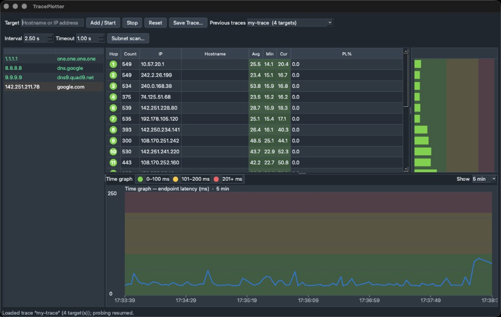
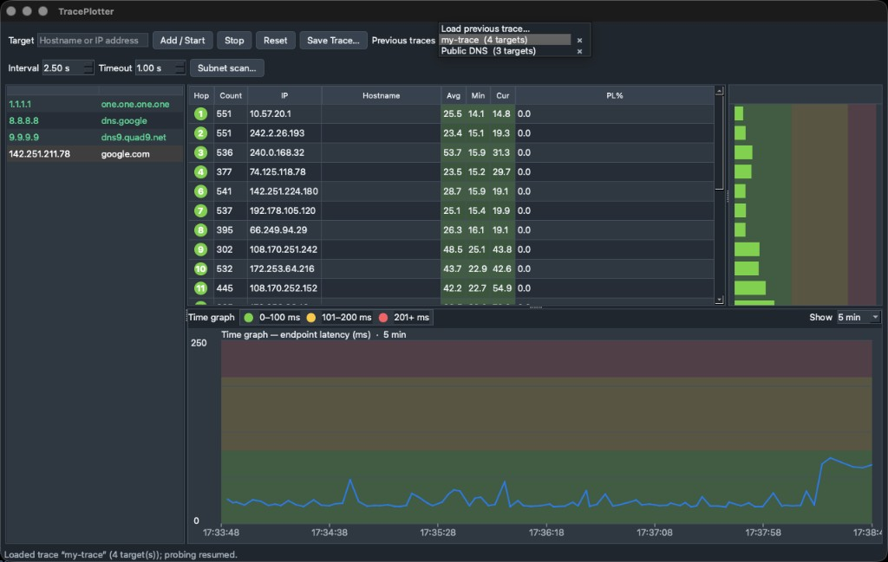
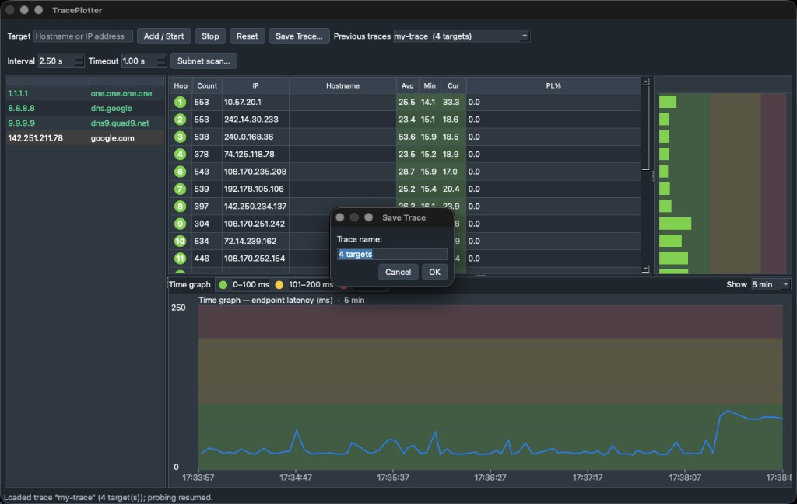
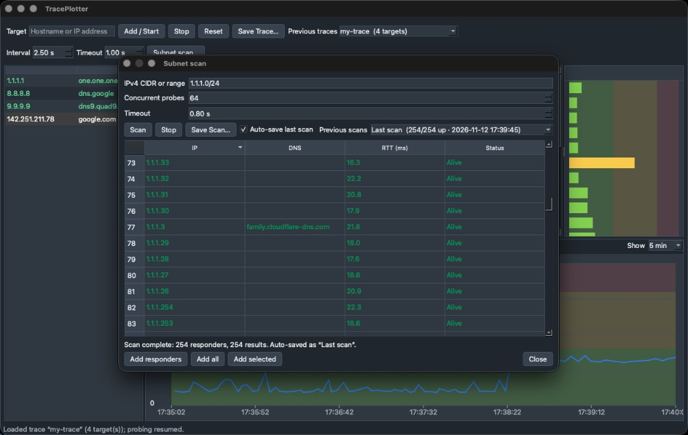
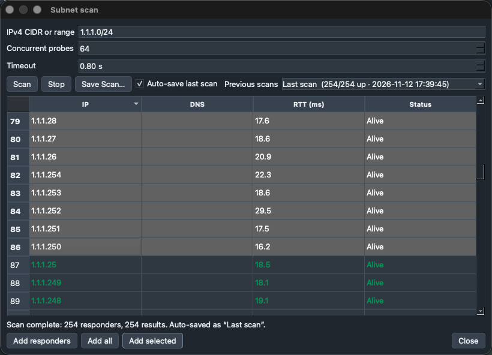
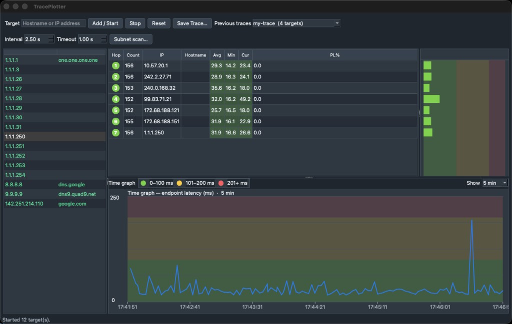

# TracePlotter

Original lab code inspired by the continuous traceroute workflow of PingPlotter. This is
a clean-room PySide6 application, not copied or decompiled PingPlotter or Angry IP Scanner
source.

## Screenshots

### Continuous traceroute

Hop table, focus bars, and rolling endpoint latency timeline for public targets
(`1.1.1.1`, `8.8.8.8`, `9.9.9.9`, `google.com`).



### Previous traces

Load a saved multi-target session from the toolbar dropdown (with per-trace delete).



### Save trace

Name and keep the current traceroute session for later.



### Subnet scan

Scan an IPv4 CIDR or range, then add responders into the traceroute list.





### Multi-target monitoring

After a subnet scan, many hosts can be traced at once with shared hop and timeline views.



## Features

- Multiple continuously sampled traceroute targets
- Live hop table with sent, loss, and latency statistics
- Rolling latency timeline (drag to scrub history; right-click to reset to live)
- Subnet IPv4 CIDR/range scan with responder, all-host, and selected-host actions
- Saved traces with load / delete from the toolbar
- Unprivileged `/sbin/ping` and `/usr/sbin/traceroute` on macOS (no `sudo` by default)
- `/24` default scan safety cap; `/23` and `/22` require confirmation

## Run on Apple Silicon

Install an arm64 Python 3.12+ (Homebrew or python.org), then:

```bash
./scripts/run-traceplotter.sh
```

The script creates `.venv`, installs the project, verifies the Python architecture is
`arm64`, and starts the app. To skip dependency installation after the first run:

```bash
TRACEPLOTTER_SKIP_INSTALL=1 ./scripts/run-traceplotter.sh
```

Tests:

```bash
.venv/bin/python -m pytest
```

Saved data lives under `~/Library/Application Support/TracePlotter/` (migrated
automatically from `LabPingPlot` on first launch).

Subnet scans can target any reachable IPv4 network; they are not restricted to the local
LAN. Scanning a subnet does not imply that firewalls will permit ICMP replies.
